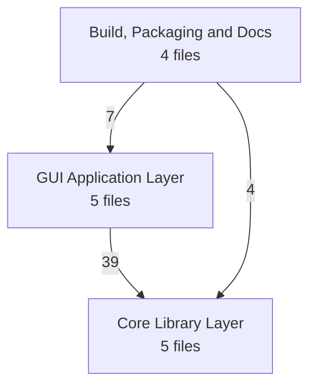
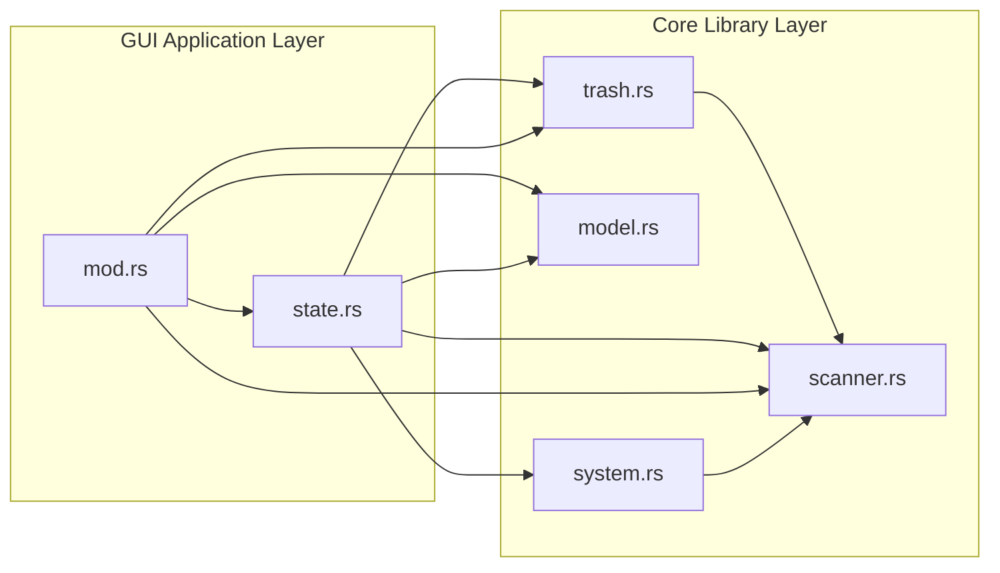

# MacCleanUp

MacCleanUp is a standalone macOS cleanup app with a native window interface written in Rust (eframe/egui). It covers the everyday Clean, Uninstall, Installer, Analyze, and Status workflows of Mole. It does not run Mole, shell cleanup scripts, Homebrew, or privileged commands. The only other programs it starts are `tmutil listlocalsnapshots /`, which reads the snapshot list for the System view, `open -R` for Show in Finder, and `osascript` when Finder must move an item for it (see Safety model).

## Run

Open `MacCleanUp.app`.

- macOS 12.0 or later
- Apple Silicon and Intel
- No Rust, Homebrew, Mole, or other package installation required on the target Mac
- All program code and resources live inside the app bundle. The interface uses the Avenir Next fonts that ship with macOS.

`Contents/MacOS/MacCleanUp --version` prints the version without opening a window.

## Layout

A sidebar lists the views. Lists show a details panel on the right: where the item lives, its size, when it last changed, what it is, and what happens when it moves to Trash. The status bar shows the last result and any running scan, with a Stop button.

- **Overview:** free space on the startup disk, and a storage bar split into Applications, Caches and logs, Installer files (once scanned), everything else in use, and free space. Below it, each cleanup area with its total and a button to review it.
- **Caches and logs:** user caches, logs, temporary files, Xcode DerivedData, Xcode device support files (iOS, watchOS, tvOS, and visionOS), CoreSimulator caches, and the npm download cache. Every item starts unselected.
- **Applications:** apps in `/Applications` and `~/Applications`, including one nested level, with version, bundle ID, size, and last change. The details panel lists exactly what uninstall moves: the app plus its exact bundle-ID cache and log folders. A checkbox, off for every app, also moves the app's settings and data named after its exact bundle ID in `~/Library`: `Application Support/<id>`, `Preferences/<id>.plist`, `Saved Application State/<id>.savedState`, `HTTPStorages/<id>`, and `WebKit/<id>`. The details panel lists each of these paths before you tick the box. Documents, containers, group containers, and folders with any other name always stay. Most browsers keep their profiles under another name, so those stay too; Opera keeps its profile in `Application Support/com.operasoftware.Opera`, so for Opera the option moves it. Containers are left out because macOS asks for permission before another app's container can be read or moved.
- **Installer files:** `.dmg`, `.pkg`, `.mpkg`, `.iso`, and `.xip` files, plus `.pkg` and `.mpkg` bundle folders, in `~/Downloads`, `~/Desktop`, `~/Documents`, `~/Public`, `~/Library/Downloads`, and iCloud Drive's Downloads folder, directly or one folder below. ZIP archives are not inspected.
- **Large old files:** files that use 1 GB or more on disk and have not changed for 180 days, anywhere in the home folder except `~/Library` and the Trash.
- **Build folders:** Cargo `target` folders that contain `CACHEDIR.TAG`, and npm `node_modules` folders next to a `package.json`, anywhere in the home folder except `~/Library` and the Trash.
- **Disk map:** the items in a folder drawn to scale as a treemap, with a sortable list below it. Click a tile or row for details; double-click a folder to open it. Use Up, the breadcrumb path, or the path field (`~` is accepted) to move around. Sizes of large folders are kept until you quit, so going back to a folder you already measured is fast. **Measure again** discards them, and any Trash operation discards the sizes it changed. The home folder itself, its standard top-level folders, shell profiles, `.ssh`, `.gnupg`, `.vault`, `~/Library/Keychains`, and anything outside the home folder (including external volumes) are protected and cannot be moved. The check ignores letter case.
- **System:** processor, macOS version, memory, startup disk use, load average, and uptime, updated every 2 seconds. Below them, the size of the Trash and the number of Time Machine local snapshots. If macOS does not let MacCleanUp read the Trash, the size shows as unavailable, not as zero.
- **Activity:** every Trash operation since the app opened, with each path that moved and any failures.

Caches and Applications scan together when the app opens. Installer files, Large old files, Build folders, and Disk map wait for a click, because they read Desktop, Documents, and Downloads, and macOS may ask MacCleanUp for access to those folders the first time. The two searches do not open `~/Library`, the Trash, app bundles, or Photos libraries, and do not cross onto other volumes.

Scans measure folders on all processor cores. A progress bar in the status bar, and above the list or disk map being scanned, shows the share of items finished and how many files and folders have been read. **Stop** (or `Esc`) ends the scan within a moment. A stopped view stays unscanned until you scan it again.

Lists can be filtered by name and sorted by name, size, or last change.

Version 0.4.1 does not implement Mole's Optimize, Purge, Slim, Touch ID, update, or administrator-only workflows.

## Keyboard

| Key | Action |
| --- | --- |
| `Cmd-1` to `Cmd-9` | Switch view |
| `Cmd-R` | Scan the current view again |
| `↑` / `↓` | Move through a list |
| `Space` | Select the highlighted item |
| `Esc` | Stop a running scan |

The review dialog lists every path that will move and its size. `Return` and `Esc` both cancel it; only a click on **Move to Trash** proceeds. A Trash operation cannot be stopped, and the window stays open until it finishes.

## Safety model

- No automatic deletion, permanent deletion, Trash emptying, or permanent-delete fallback.
- Scanning and selection happen before an explicit confirmation.
- Cleanup paths must remain inside fixed user-owned roots. Relative paths, `..`, control characters, root directories, and missing paths are rejected.
- Each kind of item has its own guard, checked again just before it moves. Large files and build folders must be inside the home folder, outside `~/Library` and the Trash, and not protected. A build folder must still contain `CACHEDIR.TAG`, or sit next to a `package.json`. App settings and data must be exactly one of the listed names inside the real `~/Library` folder.
- A bundle ID read from an app's `Info.plist` is used in a path only if it is one plain name: not empty, no `/`, no leading `.`, and no control characters.
- File and parent device/inode identities are captured during scanning and rechecked immediately before each Trash operation. This includes the caches, logs, and data that uninstall moves with an app. Changed or unknown identities are skipped.
- Directory sizing does not follow symlinks or cross mounted filesystems. Partial sizes, including app sizes, are shown in amber; unavailable bytes are not presented as a known-empty directory. One unreadable item in a Disk map folder is skipped and listed; it does not hide the rest of the folder.
- App caches and data are not removed if the app move fails or another unselected installed copy uses the same bundle ID. The uninstall preview and the operation use the same function, so they cannot disagree.
- Trash failures are reported item by item.
- When macOS answers that MacCleanUp has no permission to move an item, MacCleanUp asks Finder to move that one item to the Trash. This can happen in a Documents or Desktop folder that cloud sync manages. Finder may ask for an administrator password when the item belongs to another user. Put Back still works. The path goes to the script as an argument, not as script text. The first time, macOS asks whether MacCleanUp may control Finder. MacCleanUp never runs itself as root: a move made as root would go to root's Trash, where Put Back does not work.
- MacCleanUp does not terminate running apps. Close an app before removing its caches or uninstalling it.
- Sizes are space used on disk (allocated blocks), and a file with several hard links counts once per measured item, as `du` reports. Sparse files count only the blocks they use. APFS clones that share blocks can still be counted more than once.

## Build on a development Mac

Building requires Rust; running the result does not.

```sh
cargo test
cargo clippy --all-targets -- -D warnings
./scripts/build-app.sh
```

The build creates `build/<version>/MacCleanUp.app` from a fresh staging folder, verifies its plist and ad-hoc signature, and checks that the binary contains `arm64` and `x86_64` slices. It refuses to overwrite an existing build of the same version.

The interface tests run headless through `egui_kittest` and never open a window. Set `MACCLEANUP_SHOTS=<folder>` to save a PNG of each tested screen.

On this Mac's iCloud-synced Desktop and Documents folders, macOS can attach `FinderInfo`, `macl`, or provenance attributes after packaging or first launch. A later strict signature check can then report `resource fork, Finder information, or similar detritus not allowed`, while the non-strict check passes. The bundle is ad-hoc signed, not notarized.

## Source layout

- `src/scanner.rs`: bounded read-only inventories and searches, parallel on-disk sizing, containment, and identity checks
- `src/trash.rs`: reviewed operations through `NSFileManager.trashItemAtURL`, and the shared uninstall preview
- `src/system.rs`: macOS system metrics, Trash size, and the local snapshot count
- `src/gui/state.rs`: views, background jobs, selection, review dialogs, and the activity log, independent of drawing
- `src/gui/mod.rs`: window layout, views, dialogs, and headless interface tests
- `src/gui/theme.rs`: colors, fonts, and widget style
- `src/gui/treemap.rs`: squarified treemap layout for the disk map
- `src/main.rs`: command-line flags and window setup

<!-- git-understand:start -->
## Project map

MacCleanUp has two parts: a library that finds, sizes and guards files, and an egui window that drives it. All 39 links between the two point from the window into the library, so the library does not depend on the interface. The structure shown here is one commit older than the history.

- src/scanner.rs has the most incoming links (6). It holds the path guards and identity checks that src/trash.rs runs before every move.
- Only src/trash.rs moves anything to the Trash. The window reaches it through accept_confirmation in src/gui/state.rs.
- format_bytes in src/model.rs is the most called function, with 12 calls.
- src/gui/mod.rs is the largest hotspot: 2,159 lines, changed in all 3 commits.

### Architecture

The GUI layer makes 39 links into the Core Library layer, and 32 of them are calls. No link goes back from the library to the GUI, so the library tests run without a window.



### Dependencies

src/scanner.rs and src/model.rs are the two files that most others depend on. src/trash.rs calls the guard and identity functions in src/scanner.rs before each move.

6 of 14 files: the most connected ones, test files left out, joined by the 10 strongest of the 30 links between them.



### Composition

The Rust source is 6,236 lines in 10 files. Cargo.lock is most of the rest, at 4,638 lines.

42 files, 11293 lines.

| Language | Files | Lines |
|---|---:|---:|
| Rust | 10 | 6236 |
| Lockfile | 1 | 4638 |
| Docs | 3 | 204 |
| Other | 20 | 85 |
| Shell | 1 | 83 |
| TOML | 1 | 32 |
| Config | 3 | 12 |
| JavaScript | 2 | 2 |

### History

The history has 3 commits from one day, and each release changed most files. The pairs that change together, such as scripts/build-app.sh with the source files, come from version bumps, not from code that depends on each other.

3 commits, 2026-11-23.

| Hotspot | Commits | Lines |
|---|---:|---:|
| `src/gui/mod.rs` | 3 | 2159 |
| `src/scanner.rs` | 3 | 1589 |
| `src/gui/state.rs` | 3 | 1363 |
| `src/trash.rs` | 3 | 436 |
| `src/system.rs` | 3 | 247 |
| `src/model.rs` | 2 | 146 |
| `scripts/build-app.sh` | 3 | 83 |

src/gui/mod.rs, src/scanner.rs and src/gui/state.rs are complex, and each one changed in every commit. Those three files hold most of the Rust code, so most of the risk sits there too.

| Changed together | Commits | Linked in code |
|---|---:|---|
| `scripts/build-app.sh` + `src/gui/mod.rs` | 3 | no |
| `scripts/build-app.sh` + `src/gui/state.rs` | 3 | no |
| `scripts/build-app.sh` + `src/scanner.rs` | 3 | no |
| `scripts/build-app.sh` + `src/system.rs` | 3 | no |
| `scripts/build-app.sh` + `src/trash.rs` | 3 | no |
| `src/gui/mod.rs` + `src/gui/state.rs` | 3 | yes |
| `src/gui/mod.rs` + `src/scanner.rs` | 3 | yes |
| `src/gui/mod.rs` + `src/system.rs` | 3 | no |

<!-- git-understand:end -->

## Reference

Mole 1.74.0 (GPL-3.0) supplied the behavior and safety requirements reviewed for this independent implementation. No Mole scripts or binaries are bundled or invoked.

## License

MIT
